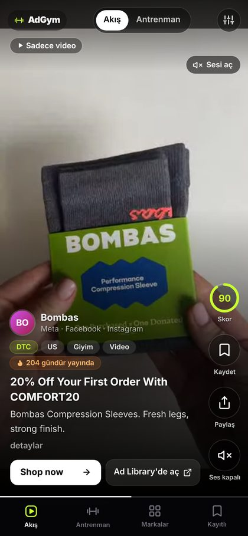
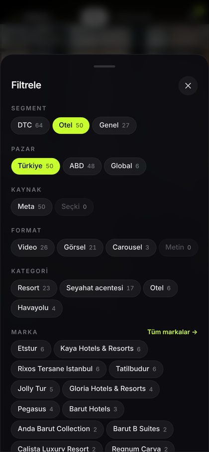
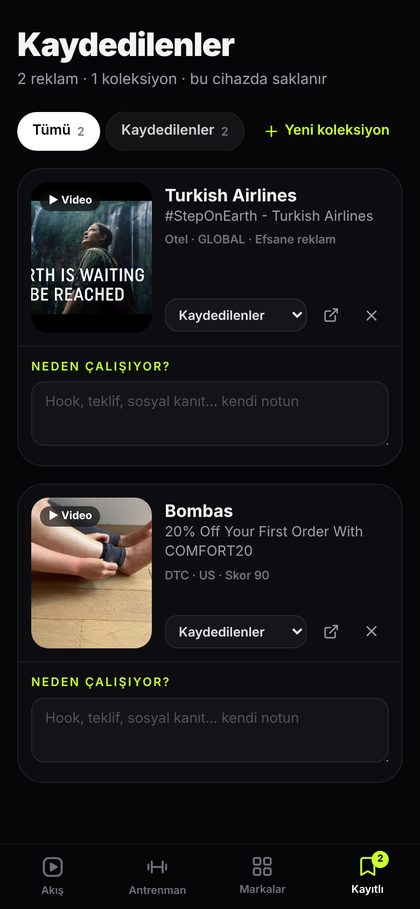
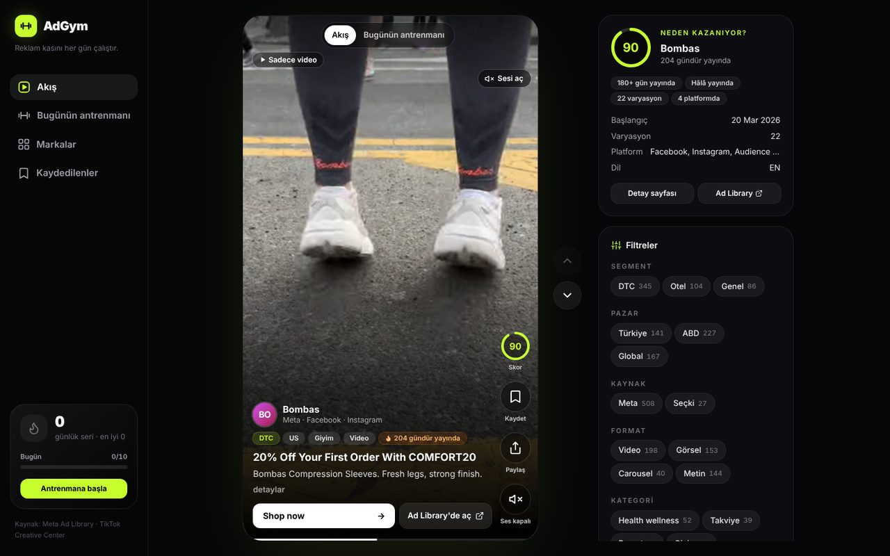

# AdGym: Reklam kasını her gün çalıştır

**Gerçekten işe yarayan reklamları TikTok gibi kaydırarak izle, her gün 10 reklamla pazarlama sezgini geliştir.**

## Ne işe yarar?

- **Reklam kasını her gün çalıştırırsın.** "Bugünün antrenmanı" her gün sana 10 güçlü reklam seçer. İlerlemeni ve seri (streak) sayını tutar.
- **Kazanan gerçek reklamları kaydırırsın.** DTC markalar, oteller ve turizm, Türkiye ve ABD'den reklamlar gelir. Hepsi Meta Ad Library'den ve elle seçilmiş efsane reklamlardan alınır. Videolar akışın içinde oynar, ayrıca bir yere gitmen gerekmez.
- **Neden kazandığını görürsün.** Her reklamda kaç gündür yayında olduğu, kaç varyasyonla ölçeklendiği ve 0–100 arası bir "kazanan skoru" yazar.
- **Beğendiğini kaydedersin.** Reklamları koleksiyonlara ayırırsın ve her birine "neden çalışıyor?" notu düşersin.
- **Ekibinle paylaşırsın.** Her reklamın kendi linki var. WhatsApp'tan ya da linki kopyalayarak gönderebilirsin.

## Ekran görüntüleri

| Akış (video) | Filtreler | Kaydedilenler |
|---|---|---|
|  |  |  |



## Nasıl denerim?

**Demo:** 👉 **[adgym-ipek-palas.vercel.app](https://adgym-ipek-palas.vercel.app)** — telefondan aç, kaydırmaya başla.

Telefonda aç ve yukarı kaydır. Videolar sessiz başlar, sesi açmak için **"Sesi aç"** düğmesine dokun. Videoya dokunursan durur ya da devam eder.
Masaüstünde `↑ / ↓` (ya da `j / k`) ile gezinebilir, `s` ile kaydedebilir, `m` ile sesi açıp kapatabilirsin.

## Vercel'e 2 dakikada deploy

[](https://vercel.com/new/clone?repository-url=https://github.com/tufancoskun/ercannoduran)

En kolayı yukarıdaki düğme. Elle yapmak istersen:

1. [vercel.com](https://vercel.com)'a GitHub hesabınla giriş yap.
2. **Add New… → Project**'e tıkla.
3. Listeden bu repoyu (`ercannoduran`) bul ve **Import**'a bas.
4. **Framework Preset** kısmında **Next.js** seçili olsun. Başka bir ayara dokunma.
5. **Deploy**'a bas. 1–2 dakika sonra sitenin linki hazır olur.

**Settings → Environment Variables** bölümüne önce aşağıdaki [Giriş](#giriş) değişkenlerini ekle (zorunlu). Şunlar ise isteğe bağlı:

| Değişken | Ne işe yarar |
|---|---|
| `NEXT_PUBLIC_SITE_URL` | Paylaşım linkleri ve önizleme görselleri için kendi alan adın (ör. `https://adgym.com`). Verilmezse Vercel linki kullanılır. |
| `META_AD_LIBRARY_TOKEN` | Sadece veri toplama (ingest) scriptleri için. Site çalışırken gerekmez. |
| `TIKTOK_CLIENT_KEY`, `TIKTOK_CLIENT_SECRET` | Sadece TikTok ingest scripti için. |

Repoya her yeni commit geldiğinde Vercel siteyi kendiliğinden yeniden kurar. Reklamların "kaç gündür yayında" bilgisi ve skorları günde bir kez kendiliğinden tazelenir.

## Giriş

Site bir yönetici hesabıyla (isteğe bağlı bir izleyici hesabıyla da) kilitlidir: giriş yapmayan herkes `/login` sayfasına yönlenir. Kullanıcı adı ve şifre koda yazılmaz, sadece ortam değişkenlerinden okunur:

| Değişken | Ne işe yarar |
|---|---|
| `ADMIN_USERNAME` | Giriş kullanıcı adı. |
| `ADMIN_PASSWORD` | Giriş şifresi. |
| `AUTH_SECRET` | Oturum çerezini imzalayan gizli anahtar (en az 16 karakter). `openssl rand -hex 32` ile üret. Değiştirirsen herkesin oturumu kapanır. |
| `VIEWER_USERNAME`, `VIEWER_PASSWORD` | İsteğe bağlı ikinci hesap ("izleyici"). Her şeyi kullanır ama Gemini özetleme (✨ Özetle) yapamaz; mevcut özetleri ve notları görür. Verilmezse sadece yönetici hesabı vardır. |

Vercel'de bunları **Production** ve **Preview** için ekle (tip: *Sensitive*), sonra yeniden deploy et. Biri eksikse site açık kalmaz, `503` sayfası gösterir.
Yerelde `.env.local` dosyasına yazabilirsin (git'e girmez). "Beni hatırla" işaretliyse oturum 30 gün sürer, değilse tarayıcı kapanınca biter. Çıkış için **Kaydedilenler** sayfasının altındaki **Çıkış yap** düğmesini kullan.

---

## Geliştiriciler için

### Yerelde çalıştırma

Gereksinim: Node.js 20+ (ingest scriptleri için Node 22 önerilir).

```bash
npm install
npm run dev        # http://localhost:3000
```

Üretim derlemesi:

```bash
npm run build
npm start
npm run lint
```

### Nasıl çalışır?

- **Akış:** tam ekran ve kaydırmalı. Görünür olan video sessiz ve `playsInline` olarak kendiliğinden oynar, sıradaki video önceden yüklenir. Altta TikTok tarzı bir ilerleme çubuğu vardır. Ses tercihi bir slayttan diğerine taşınır. Carousel'ler yana kayar.
- **Sıralama:** Önce oynatılabilir videosu olan reklamlar gelir, sonra görsel ve carousel'ler, en son sadece metin olanlar. Her grup kendi içinde skora göre sıralanır, aralara her ~5 reklamda bir "Efsane" klasik serpiştirilir.
- **"Sadece video"** düğmesi akışı `?format=video` ile filtreler. Diğer filtreler de (segment, pazar, kaynak, format, kategori, marka) URL'de tutulur, yani filtreli akış paylaşılabilir.
- **Kaydedilenler** tarayıcıda (`localStorage`) tutulur. Hesap ya da veritabanı yoktur.
- **Paylaş:** her reklamın `/ad/[id]` sayfası (OG etiketli), sistem paylaşım menüsü, link kopyalama ve WhatsApp.

### "Kazanan" skoru

Ticari reklamların harcaması açık olmadığı için skor yayında kalma süresi ve ölçeklenme sinyallerinden üretilir. Tek bir formül vardır: `src/lib/score.ts`. `scripts/ingest/score.mjs` bunun satır satır JS kopyasıdır, ikisi birlikte değiştirilmelidir.

| Sinyal | Puan |
|---|---|
| Taban | 10 |
| Yayında ≥7 / ≥30 / ≥90 / ≥180 / ≥365 gün | +5 / +20 / +35 / +42 / +48 |
| Hâlâ yayında | +12 |
| Varyasyon ≥2 / ≥5 / ≥10 | +6 / +12 / +18 |
| Platform ≥2 / ≥3 | +5 / +8 |
| TikTok Top Ads sırası ≤10 / ≤50 / herhangi | +16 / +12 / +8 |
| TikTok CTR yüzdeliği ≥80 · beğeni ≥100B | +6 · +6 |
| Elle seçilmiş klasik ("Efsane") | en az 85 |

Uygulama veriyi okurken her reklamın skorunu bu sinyallerden **yeniden hesaplar**. Gün sayısı `startedAt` ile bugün arasından bulunur. Bu yüzden veri dosyalarındaki eski skorlar ya da farklı gerekçe metinleri ekrana yansımaz.

### Veri

Uygulamanın veritabanı yok. Reklamlar `data/ads/*.json` dosyalarından okunur. Her dosya `{ "generatedAt": string, "ads": Ad[] }` biçimindedir, şema `src/lib/types.ts`'de. Klasöre yeni bir `.json` dosyası eklemek yeterli, kod değişikliği gerekmez.

| Dosya | İçerik |
|---|---|
| `data/ads/meta-tr.json`, `meta-us.json` | Meta Ad Library: Türkiye / ABD |
| `data/ads/meta-picks.json` | Elle seçilmiş ek Meta reklamları |
| `data/ads/superscale.json` | Superscale panolarından yüksek performanslı reklamlar (`docs/SUPERSCALE.md`) |
| `data/ads/tiktok.json` | TikTok reklamları |
| `data/ads/curated.json` | Elle seçilmiş klasikler (YouTube videoları) |
| `data/media/*.json` | Medya zenginleştirme katmanı (`{ generatedAt, items: { [adId]: {...} } }`): görsel/video URL'leri, metin, CTA |
| `public/media/meta/*.jpg` | Bizim sakladığımız kapak görselleri (CDN linkleri dolunca yedek) |

`src/lib/ads.ts` tüm dosyaları okur, bozuk dosyaları atlar ve medya katmanını id ile birleştirir. Ardından `id`'ye göre tekilleştirir, skoru yeniden hesaplar ve sıralar. Hiç reklam yoksa örnek veri (`src/lib/fixtures.ts`) ve "Demo verisi" etiketi gösterilir.

Veri dosyaları Vercel'de sunucu paketine dahil edilir (`next.config.ts` → `outputFileTracingIncludes`). Build'den sonra eklenen bir reklamın `/ad/[id]` sayfası istek anında üretilir, bilinmeyen id'ler temiz bir 404 döner.

### Veriyi yenileme

```bash
META_AD_LIBRARY_TOKEN=... npm run ingest      # hepsi
META_AD_LIBRARY_TOKEN=... npm run ingest:meta # sadece Meta
npm run ingest:tiktok                         # sadece TikTok (TIKTOK_* env değişkenleri)
node scripts/ingest/enrich-meta-media.mjs     # Meta reklamlarına görsel/video ekler
```

Ayrıntılar için `docs/INGESTION.md`'ye bak. İzlenen markalar `data/brands.json`'da. Değişen `data/` dosyalarını commit'lediğinde Vercel otomatik olarak yeniden kurar.

### Sınırlamalar

- **Medya linklerinin süresi dolar.** fbcdn/tiktokcdn linkleri birkaç gün sonra geçersiz olur. Uygulama bunu bekler: video açılmazsa kapak görseline (bizim kopyamız `public/media/meta`), o da yoksa marka renkli metin kartına sessizce düşer. Düzenli `ingest` + `enrich` önerilir.
- **Medyası olmayan reklamlar.** Ad Library'den medyası alınamayan reklamlar metin kartı olarak gösterilir. Bu kartlar akışın sonunda yer alır.
- **Skor bir tahmindir.** Harcama ve dönüşüm verisi açık değildir. Skor yalnızca uzun süre yayında kalmaya ve ölçeklenmeye dayanır.
- **Veriler cihaza özel.** Kaydedilenler ve seri bilgisi tarayıcıda tutulur, cihazlar arasında taşınmaz.
- **İlk yükleme boyutu.** Tüm reklam listesi ana sayfayla birlikte gelir (~250 KB sıkıştırılmış). Veri çok büyürse sayfalı yüklemeye geçmek gerekir.

### Proje yapısı

```
src/app/            sayfalar: / (akış), /ad/[id], /saved, /brands
src/components/     Feed, AdCard, AdMediaView, TextCard, FilterPanel, SavedView, BrandsView, ...
src/lib/            types, score, ads (sunucu tarafı yükleyici), filters, daily, saved, youtube
scripts/ingest/     veri toplama scriptleri (Node ESM, ek bağımlılık yok)
data/               reklam JSON'ları, medya katmanı ve marka listesi
docs/               SPEC, INGESTION, ekran görüntüleri
```
